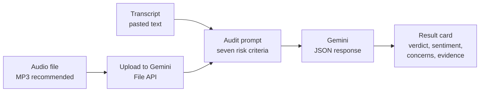

# AI Call Quality Auditor


An automated QA reviewer for customer-service calls. Paste a transcript or upload a recording, and the app returns a pass or fail verdict, the customer's sentiment, the top concerns and the exact lines that support each concern.

## Why

Contact centers usually review a small random sample of calls by hand, so most compliance problems and escalations go unseen. This app reviews every call against the same criteria in seconds and shows its evidence, so a supervisor can check the verdict instead of trusting it blindly.

## How it works



1. **Input.** Either a text transcript or an audio recording. Audio goes straight to Gemini's multimodal API, so there is no separate speech-to-text step.
2. **Audit.** The model checks the call for rude or unprofessional agent behavior, customer frustration, escalation triggers, policy or compliance violations, misinformation, safety or legal risks, and repeated unresolved issues.
3. **JSON output.** The model is asked to answer in JSON with these fields, and the app parses it into a result card:

| Field | Meaning |
|---|---|
| `pass_fail` | Overall verdict for the call |
| `sentiment` | Customer sentiment |
| `top_concerns` | The most serious issues found |
| `evidence` | Quotes from the call that back each concern |

## Run it locally

```bash
git clone https://github.com/Jaswanthnani02/call-auditor-app.git
cd call-auditor-app
pip install -r requirements.txt
cp .env.example .env    # then add your Gemini API key
streamlit run app.py
```

If no key is set in `.env`, the app asks for one in the sidebar. Keys entered there are used for that session only.

## Project structure

| File | Purpose |
|---|---|
| `app.py` | Streamlit UI: input tabs, analysis trigger, result display |
| `analyzer.py` | Gemini integration: file upload, prompt, typed response schema |
| `list_models.py` | Lists the Gemini models available to your key |
| `deployment_guide.md` | Steps for deploying to Streamlit Community Cloud |

## Stack

Python, Streamlit, Google Gemini (multimodal, structured output), python-dotenv.
